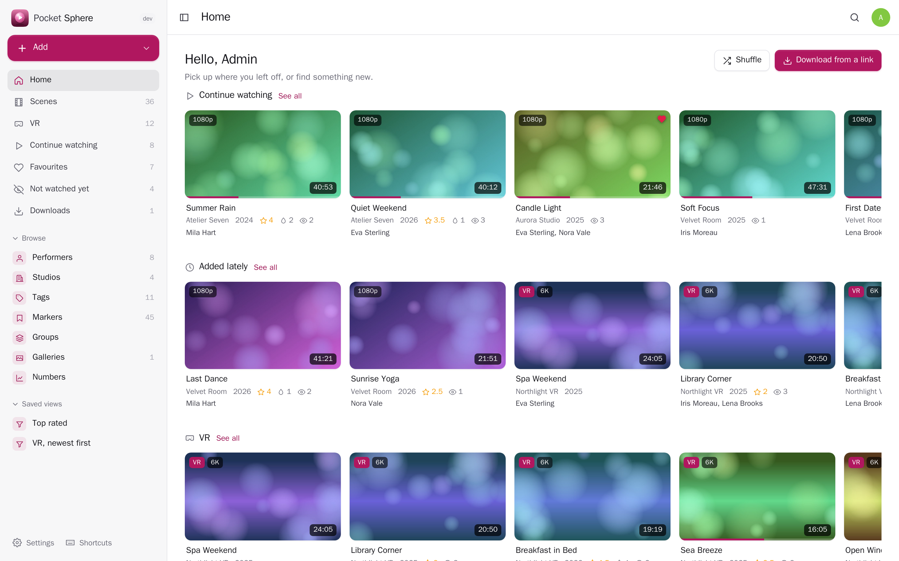
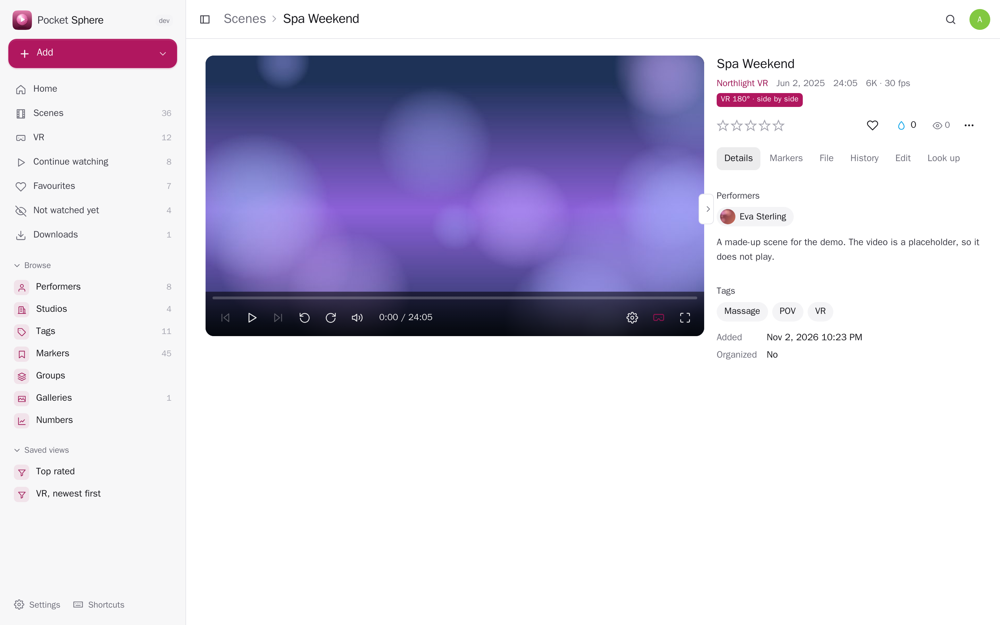
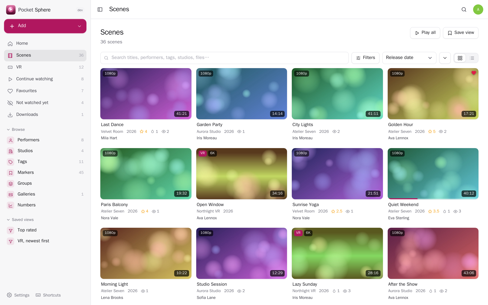
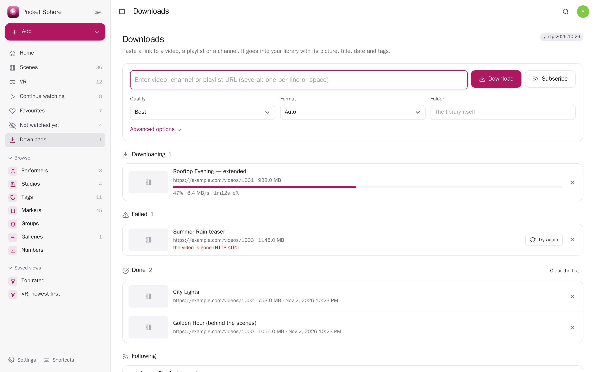
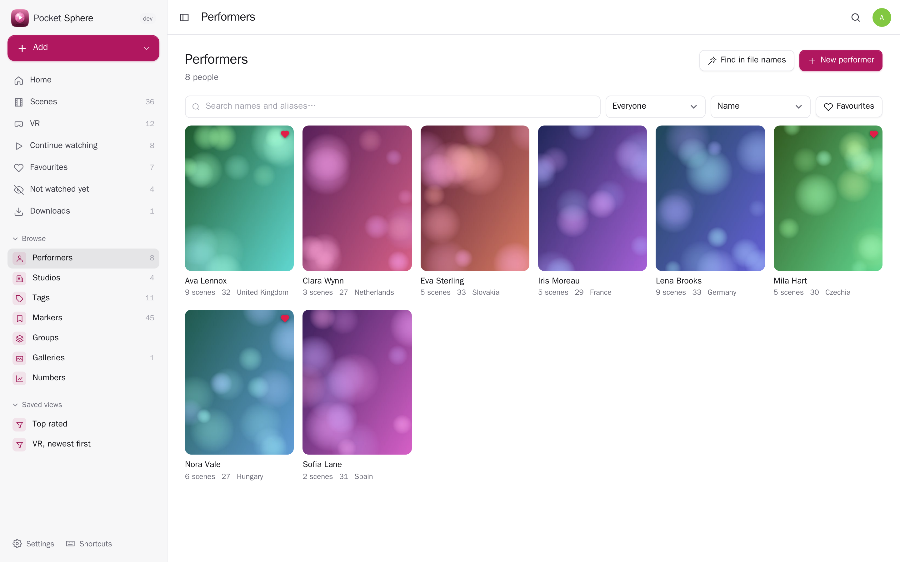
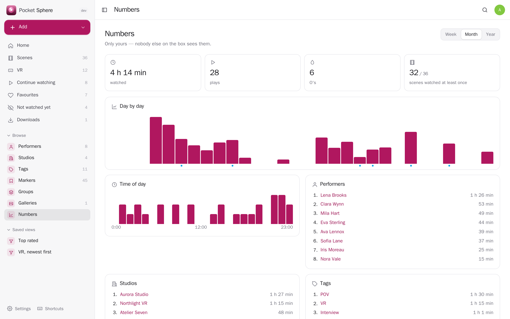
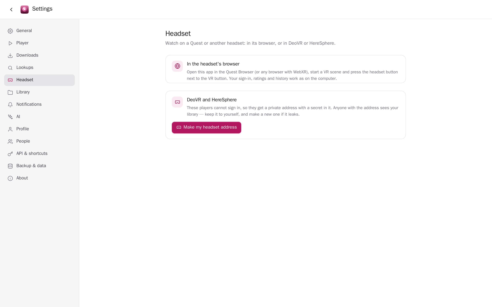
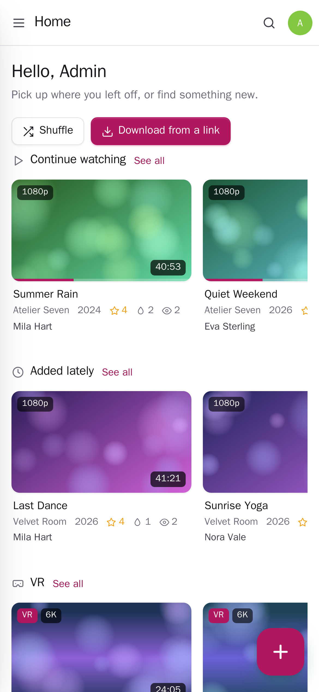
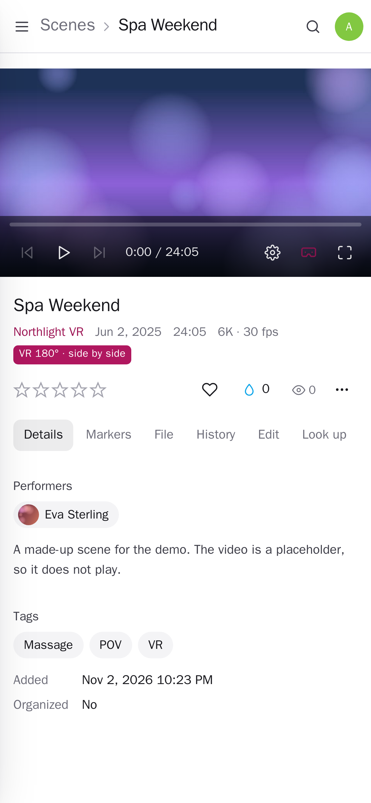

<p align="center"></p>

<h1 align="center">Pocket Sphere</h1>

<p align="center">Your video library with a VR player: scenes, performers, studios, tags and markers, previews when you point at a scene, fingerprints that find what a file is, downloads from a link, and DeoVR / HereSphere on the headset. A Stash replacement. One Go binary, one SQLite file, one volume. Part of the Pocket apps; works on its own too.</p>

<p align="center">
  <a href="https://github.com/abjelosevic88/pocket-homelab-sphere/actions/workflows/ci.yml"></a>
  <a href="https://github.com/abjelosevic88/pocket-homelab-sphere/pkgs/container/pocket-homelab-sphere"></a>
  <a href="LICENSE"></a>
</p>

<p align="center"></p>

<table>
  <tr>
    <td></td>
    <td></td>
  </tr>
  <tr>
    <td></td>
    <td></td>
  </tr>
  <tr>
    <td></td>
    <td></td>
  </tr>
</table>

<p align="center">
  
  
</p>

The screenshots show the demo library: made-up names and abstract pictures.

## What it does

- **A VR player in the browser** — 180° and 360° videos, fisheye lenses (190°, MKX200, MKX220), side by side or top/bottom: drag to look around, scroll to zoom. In a headset's browser (Quest), one button puts you inside the video (WebXR). VR scenes are found from their names and frame shapes; you can set the shape by hand.
- **Plays anything** — files the browser can play are sent as they are (instant seeking); the rest are repackaged or converted while you watch, on an Intel/AMD GPU when you have one.
- **DeoVR and HereSphere** — each person gets their own address the headset players read. HereSphere writes ratings and favourites back and reports where you stopped.
- **Scenes like Stash** — performers, studios (with networks), tags (with parents), groups (movies, series), markers, galleries of pictures, ratings with half stars, an O counter, favourites, play history, “continue watching”, saved views, a play queue from any list, bulk edits, duplicates found by picture.
- **Pictures made for you** — covers, a scrubber with pictures and a strip under the player, short silent previews when you point at a scene, marker clips. VR videos get flat pictures, not the doubled fisheye frame.
- **Find out what a file is** — the same fingerprints as Stash (oshash, phash) look scenes up on StashDB or another stash-box, and TPDB by hash or name: title, date, studio, performers with photos, tags, cover in one click — or by themselves for new files.
- **Downloads from a link, like MeTube** — paste a video, playlist or channel link (or press ⌘V anywhere), pick quality, format and folder; clips, name prefix, items limit, passwords and your own cookies.txt for sites that need a sign-in. Follow channels to fetch new videos as they come. Title, date, description, uploader and tags come along; yt-dlp is kept up to date by itself.
- **Bring Stash over** — upload Stash's database: titles, performers, studios, tags, groups, markers, StashDB ids, and your ratings, O's, play history and resume points, matched by fingerprint.
- **Yours** — per person: ratings, history, downloads and settings are yours; admins don't see them. Blur pictures until pointed at, an escape page on Esc Esc, a PIN lock, notifications without titles. Other Pocket apps see nothing unless you switch a link on.

## Run it

```bash
docker run -d --name pocket-sphere -p 8080:8080 \
  -v ./data:/data -v /path/to/your/videos:/library \
  -e BASE_URL=https://sphere.example.com -e SECURE_COOKIES=true \
  -e ADMIN_EMAIL=you@example.com -e ADMIN_PASSWORD=change-me-please \
  ghcr.io/abjelosevic88/pocket-homelab-sphere:latest
```

Or `docker compose up -d` with [docker-compose.yml](docker-compose.yml) (it shows how to pass the GPU for `HWACCEL=vaapi`). Any folder layout works; videos show up within minutes, pictures and previews follow in the background. The image has ffmpeg and yt-dlp; a bare release binary needs `ffmpeg` (and Python for downloads) on the machine.

Everything is configured with environment variables — see [docs/configuration.md](docs/configuration.md). Backups: [docs/backup.md](docs/backup.md). Behind a proxy: [docs/reverse-proxy.md](docs/reverse-proxy.md). The API: [docs/api.md](docs/api.md).

## With Pocket Core

Set `CORE_URL` and `CORE_REGISTRATION_KEY` and Pocket Sphere joins the box: people sign in with Pocket Core and the Ask panel uses Pocket AI. On purpose it publishes only `sphere.download_finished` (no titles), so nothing about what you watch reaches a journal. Other Pocket apps can be allowed — by you, in Core — to read your library (`sphere:read`) or send links to download (`sphere:downloads`); both start off.

## Develop

```bash
make run     # web + Go, demo data, no login, http://localhost:8080
make test    # go vet, go test, tsc
```

Go 1.26, SQLite (pure Go), React 19 + Vite, plain WebGL for the VR view. The screenshots come from `scripts/screenshots.mjs` against a demo instance.

## Credits

[ffmpeg](https://ffmpeg.org) makes pictures, previews and conversions; [yt-dlp](https://github.com/yt-dlp/yt-dlp) downloads (both run as programs, not linked). Fingerprints match [Stash](https://github.com/stashapp/stash)'s, with [goimagehash](https://github.com/corona10/goimagehash). Lookups: StashDB and TPDB with your own keys.

## License

MIT © 2026 Aleksandar Bjelosevic
